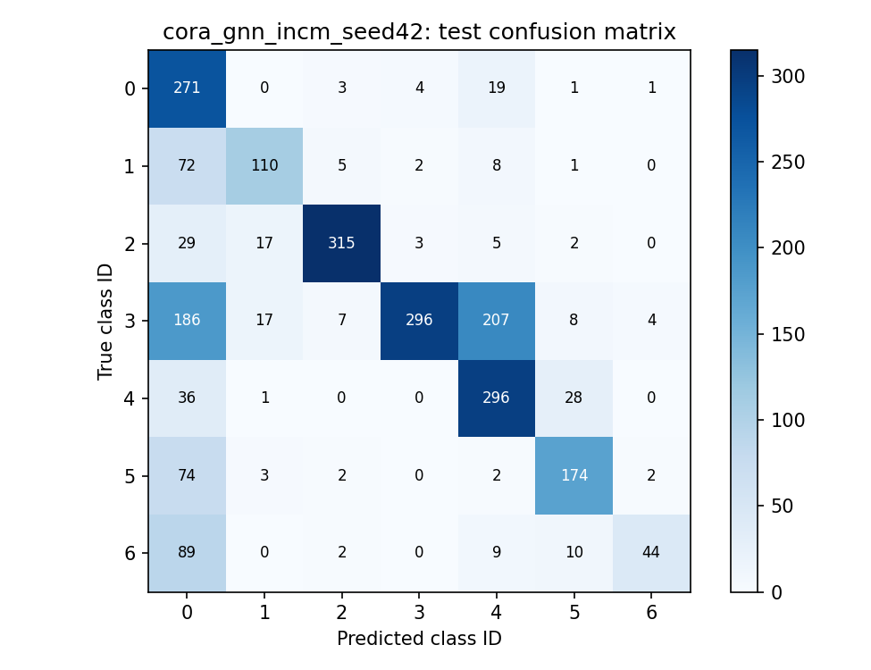

# Formal reproduction report

Independent reproduction prepared with AI assistance. Original method: Huang, Tang and Chen (2022).

## Reproduction report: GNN-INCM

### Abstract

This report documents an independent practical reproduction of the graph neural network-based imbalanced node classification model proposed by Huang, Tang and Chen (2022). A single Python implementation contains data loading, sparse graph preprocessing, a GCN baseline, embedding clustering, graph reconstruction, adaptive hard-sample weighting, training, evaluation and artifact export. Experiments use real citation graphs and validation-selected checkpoints. The study separates executable implementation from numerical replication: the measured scores do not establish reproduction of the original paper's headline results. Differences in reconstruction sampling, loss normalization, center handling, data processing and metric interpretation are made explicit. All quantitative tables derive from completed local runs; the original paper values are identified separately.

### 1. Introduction

Graph node classification combines a node's own attributes with information passed through its neighbors. In a citation network, nodes represent publications and edges represent citation relationships. When only a small fraction of publications are labeled, less common classes may supply very few training examples. A high overall accuracy can then conceal poor performance on minority classes. This motivates reporting macro metrics and class-level recall alongside accuracy. The objective of this reproduction is to build an inspectable implementation and evaluate its behavior under a reproducible low-label protocol, rather than assume that every component must improve performance.

### 2. Original paper and attribution

The source is Zhenhua Huang, Yinhao Tang and Yunwen Chen, A graph neural network-based node classification model on class-imbalanced graph data, Knowledge-Based Systems, volume 244, article 108538 (2022), DOI 10.1016/j.knosys.2022.108538. The original contribution belongs to these authors. This submission is an independent implementation and report prepared with AI assistance; it is not an author-issued reproduction. The supplied PDF was read and the algorithm and result-table pages visually checked. The authors' linked GitHub repository returned HTTP 404 during preparation, leaving several implementation details unresolved.

### Reproduction scope

The core GNN-INCM method and a controlled GCN baseline are implemented. Three ablations remove the clustering loss, reconstruction loss or hard weights. HSKDM is analyzed but not implemented. The project follows the reference repository's separation of research documentation and generated outputs while retaining all Python implementation in main.py. The notebook imports that file, uses saved results by default, and exposes an explicit option to rerun training. The study uses fixed seeds and settings rather than selecting favorable test outcomes.

## Data and evaluation protocol

### 3. Dataset

The official Planetoid distribution provides Cora, CiteSeer and PubMed features, labels and adjacency lists. Dimensions are checked against the paper. Cora has 2,708 nodes, 1,433 features and seven classes; CiteSeer has 3,327 nodes, 3,703 features and six classes; PubMed has 19,717 nodes, 500 features and three classes. Source files are cached outside the submission directory. Each run records SHA-256 hashes so checkpoint evaluation can reject changed inputs. The repository contains setup instructions rather than redistributing raw datasets.

### Graph representation

The loader reconstructs the source test ordering, symmetrizes the graph and removes duplicate edges and original self-edges. It adds self-loops for message passing and applies symmetric degree normalization. Cora has 5,278 unique undirected edges in this processed representation, compared with 5,429 links in the paper; CiteSeer has 4,552 versus 4,732; PubMed has 44,324 versus 44,338. These definitions are recorded separately. Feature rows are normalized to sum to one; zero rows remain zero. This feature normalization is a declared assumption because the paper does not specify it.

### Missing labels and class imbalance

CiteSeer contains 15 all-zero label rows associated with gaps in the Planetoid test range. They remain nodes in the transductive graph, but are excluded from all supervised masks and metrics. Assigning them to class zero would invent labels, so the implementation does not do that. The class distributions are left naturally imbalanced. Cora's full class counts, in source column order, are 351, 217, 418, 818, 426, 298 and 180. Class IDs are used in figures without guessing semantic label names.

### Protocol and leakage controls

A seeded random permutation allocates floor(3% of eligible nodes) to training. Of the remainder, floor(10%) goes to validation and all remaining nodes go to test. Thus Cora uses 81 training, 262 validation and 2,365 test nodes. Splits are not stratified or resampled based on performance. Models and ablations share the same split for each seed. Labels from validation and test do not enter class weights, k-means initialization or the training losses. The entire unlabeled graph is visible, as appropriate for a transductive task. A debug invariant explicitly changes all held-out labels and verifies that the training objective is unchanged. Validation macro F1 selects the checkpoint; test metrics are computed after selection.

## Encoder and embedding clustering

### 4. Methodology

GNN-INCM combines two cooperating objectives around a shared graph encoder. ECO supplies class-balanced supervision and a clustering regularizer; GRO tries to preserve graph structure through a decoder. A node difficulty weight influences both modules. Our implementation tracks each component separately so a decreasing combined objective cannot conceal an inactive component. This distinction matters in the present experiment, where clustering contributes very little numerically.

### 5. GCN architecture

The encoder follows Eq. (1): O = A_norm ReLU(A_norm X W0) W1, with A_norm = D^(-1/2)(A+I)D^(-1/2). It has 100 hidden units and K output dimensions, where K is the number of classes. Dropout with probability 0.3 follows ReLU. Both linear transformations omit bias terms. Cora therefore uses 144,000 trainable parameters. Sparse adjacency multiplication avoids allocating a dense graph. The output O serves both as the class logits and the embeddings used by clustering and reconstruction; there is no separate embedding head.

### 6. ECO: supervised classification

Softmax probabilities are computed from O, using stable cross-entropy on logits. For a training node of class c, the inverse-frequency coefficient is alpha = number of training nodes / (K times number of training nodes in class c). The coefficient is positive. The printed Eq. (4) has a negative sign that conflicts with the surrounding description and the minimization of cross-entropy, so this reproduction follows the intended positive weighting. The baseline GCN uses ordinary unweighted cross-entropy. INCM additionally multiplies each training-node term by its current hard weight.

### ECO: clustering assignments

K-means is run once on labeled-node embeddings from the initialized encoder. The cluster count is ceil(number of training nodes / smallest training-class count), following Eq. (5), rather than simply K. The implementation uses ten k-means initializations and fixes the resulting centers. This is an interpretation of the paper's statement that centers are initialized before training and that W0 and W1 are optimized; no center-update rule is provided. A split missing a class raises a clear error because Eq. (5) is undefined.

### Target distribution and optimization

Student-t assignments q_ij are proportional to (1 + squared distance between o_i and center u_j)^(-1). Each row is normalized. Targets p_ij square q_ij and divide by its cluster frequency, then normalize again. Targets are recomputed each epoch and detached so they act as guidance rather than another gradient path. The clustering term is the node-weighted mean KL(P||Q). The implementation sums over the actual k clusters, resolving the paper's inconsistent K upper limit in Eq. (8). No ground-truth labels from held-out nodes are used in this step.

## Reconstruction and hard samples

### 7. GRO

The decoder computes the probability of an edge as sigmoid(o_i dot o_j), following Eq. (9). Training uses binary cross-entropy with logits to avoid explicit logarithms of probabilities near zero. The printed reconstruction objective in Eqs. (10) and (14) lacks the negative sign required when minimizing a binary cross-entropy; this reproduction supplies it. The reconstruction target is the original graph without added message-passing self-loops.

### Memory-efficient approximation

A dense PubMed decoder would evaluate roughly 389 million ordered node pairs. Instead, each epoch samples up to 10,000 positive ordered edges without replacement and an equal number of off-diagonal negative pairs with replacement. Every negative pair is checked against the complete adjacency. The pair weight is the average of the two endpoint hard weights. This balanced sampled objective is not an unbiased estimate of the paper's unweighted all-pair sum: it changes positive/negative mass, excludes diagonal pairs and normalizes by sample count. It should be treated as a practical approximation with possible effects on classification.

### 8. Hard sample strategy

Algorithm 1 initializes node weights uniformly in [0.5,1]. Equation (11) compares the maximum-probability cluster under Q with that under P. Agreement divides the weight by gamma; disagreement multiplies it by gamma. The floor is 0.5. Our assumed gamma is 1.01, and a stability cap of 100 prevents unbounded growth. Neither the chosen gamma nor cap is claimed to be a published setting. Weights are updated once per epoch before losses and are not differentiated. They multiply supervised and clustering terms, while endpoint averages weight reconstruction. An easy node in this sense is not necessarily correctly classified; hardness is disagreement in unsupervised assignments.

### Joint loss and normalization

The total is classification plus clustering plus reconstruction, with no additional tuned coefficients. Each component is averaged over its own sample set. This differs from the paper's sums and alters the balance between objectives and weight decay. The no-cluster ablation still computes Q and P to preserve hard-weight updates, but removes KL from the loss. The no-reconstruction ablation removes only GRO. The no-hard ablation uses weights of one, retaining inverse-frequency alpha. Consequently none of these alone isolates alpha weighting from the other contributions.

### 9. HSKDM

The paper trains multiple INCM models using teacher-side hard-weighted distribution KL and cross-model triplet alignment. It simplifies the triplet anchor and positive to the same node, then combines the networks by voting. Margin, negative selection and several optimization details are not fully specified. Implementing ordinary averaging would not satisfy this procedure. HSKDM remains deliberately unimplemented here; no HSKDM training, checkpoint or reproduced result is claimed.

## Experiments and actual results

### 10. Experimental setup

Completed local experiments use CPU PyTorch, two CPU threads and seeds 42, 43 and 44. Adam uses learning rate 0.002, weight decay 0.03, betas 0.9/0.999 and epsilon 1e-8. Runs allow up to 1,000 epochs with early stopping after 200 epochs without improvement in validation macro F1. The paper used a GPU and ten repetitions. Our baseline deliberately shares the INCM architecture and settings for a controlled comparison; it does not reproduce the paper's baseline-specific hyperparameter choices. Histories record actual stopping epochs and best epochs.

### 11. Metrics

Accuracy is the proportion of correct predictions. Macro precision, recall and F1 average class-specific scores equally across all K classes; zero-denominator cases contribute zero. MCC uses the standard multiclass implementation. Per-class support and confusion matrices expose errors that an aggregate can hide. Standard deviations below are sample SDs over three independently seeded split-and-initialization runs, not confidence intervals. These runs quantify combined split and optimization variability.

### 12. Results

Twenty-seven non-debug experiments completed: 15 Cora runs (five model configurations times three seeds), six CiteSeer runs and six PubMed runs (GCN and GNN-INCM times three seeds on each). All used the stated 1000-epoch cap and 200-epoch patience; early stopping usually ended training sooner. No extra hyperparameter search was performed after examining test outcomes.

### Completed-run summary

| Dataset | Model | Macro F1 | MCC |
|---|---|---|---|
| citeseer | gcn | 0.5276 +/- 0.0671 | 0.5491 +/- 0.0738 |
| citeseer | gnn_incm | 0.5740 +/- 0.0108 | 0.5385 +/- 0.0194 |
| cora | gcn | 0.4032 +/- 0.2630 | 0.3690 +/- 0.3224 |
| cora | gnn_incm | 0.6432 +/- 0.0207 | 0.6033 +/- 0.0176 |
| cora | no_cluster | 0.6432 +/- 0.0207 | 0.6033 +/- 0.0176 |
| cora | no_hard | 0.6707 +/- 0.0406 | 0.6313 +/- 0.0428 |
| cora | no_reconstruction | 0.6432 +/- 0.0225 | 0.6030 +/- 0.0205 |
| pubmed | gcn | 0.7466 +/- 0.0511 | 0.6347 +/- 0.0630 |
| pubmed | gnn_incm | 0.7555 +/- 0.0046 | 0.6494 +/- 0.0064 |

### Ablation interpretation

On Cora, removing the clustering loss produces the same reported test metrics as the core model, consistent with its near-zero magnitude in the histories. Removing reconstruction changes little. Removing hard weights produces a higher mean macro F1 than the core configuration. These results do not support the original paper's claim that all components improve performance under our chosen implementation settings. The comparison with unweighted GCN is also confounded by alpha class weighting and cannot assign improvement solely to ECO or GRO.

## Comparison and error analysis

### 13. Paper-versus-our-results comparison

The paper's Table 2 reports Cora GNN-INCM F1 0.7508 +/- 0.0045 and MCC 0.7237 +/- 0.0051; CiteSeer 0.6490 +/- 0.0048 and 0.6274 +/- 0.0036; PubMed 0.7704 +/- 0.0039 and 0.6493 +/- 0.0059. Our machine-readable comparison table contains every core/baseline/ablation row and arithmetic differences. Unrun ablations on additional datasets remain explicitly marked. The paper gives binary formulas but does not specify multiclass F1 averaging; our macro F1 comparison is therefore descriptive, not guaranteed metric equivalence.

### Observed gap

On Cora, our mean macro F1 is 0.6432, an arithmetic difference of -0.1076 from the paper's F1. Our MCC is 0.6033, a difference of -0.1204. These gaps are not concealed by selecting a favorable run. The comparison is affected by three versus ten runs, unavailable exact splits, processed graph counts, fixed randomly initialized cluster centers, assumed feature normalization, balanced sampled reconstruction and mean rather than summed losses. CPU arithmetic may differ from GPU arithmetic, but the protocol and objective differences are more direct explanations to investigate. No causal attribution is established by this study.

### 14. Confusion matrix analysis

For Cora seed 42, class 2 achieves F1 0.8936, while class 6 has F1 0.4293 and recall 0.2857 (154 test examples). Class 0 has recall 0.9064 but precision 0.3580: many other classes are predicted as class 0. Class 3 has precision 0.9705 but recall 0.4083. These asymmetries show that strong precision or recall alone does not establish balanced classification. This is a descriptive example from a preselected seed, not an average confusion matrix or a best-seed claim.

### Figure 1. Actual Cora seed-42 test confusion matrix

## Limitations, conclusion and references

### 15. Limitations

The main scientific limitation is numerical non-reproduction. The core method runs, but the scores and ablations do not recover the original headline findings. Clustering losses are extremely small, occasionally slightly negative at float32 rounding scale. Fixed centers from an untrained encoder, row-normalized features and relatively strong weight decay with mean losses can weaken representation learning. The falling objective can also reflect declining beta weights rather than better predictions. Validation checkpoint selection mitigates later deterioration but does not solve these optimization concerns.

### Limits on claims

The three seeds are insufficient for strong statistical conclusions. No significance claim is made, and no test-based hyperparameter search was conducted. Matching the two-layer architecture does not imply exact matching of the original implementation. Edge sampling, self-pair exclusion and loss normalization are substantive changes. Baseline hyperparameters are controlled locally rather than taken from the original GCN paper. Original multiclass metric conventions remain unresolved. HSKDM, additional dataset ablations and ten-run paper-scale evaluation are unfinished. Source feature/label data are real, but their processed edge definitions are not identical to Table 1 counts.

### 16. Conclusion

This project supplies a reproducible computational record: a single source file, an executable demonstration notebook, real input provenance, saved split/checkpoint states, per-run predictions, metrics, figures and transparent comparison tables. It reproduces the core computational ideas at a practical implementation level while documenting failure to match the original numerical results. A credible next step is to resolve center initialization and loss scaling against recovered author code, then predefine a validation-only study of the ambiguous settings. Test sets should remain untouched until that study is fixed. Results should not be relabeled as a successful exact replication.

### 17. Reproducibility and submission

Install dependencies with pip install -r requirements.txt. Run python main.py --mode debug, then the train/evaluate/all commands in README.md. Open GNN_INCM_Reproduction.ipynb for the saved-results demonstration. Metrics and input hashes permit independent checks of the reported tables; the final verification record documents notebook execution and checkpoint consistency. Raw datasets are intentionally excluded from the submission and can be restored from the documented cache instructions.

### 18. References

[1] Huang, Z., Tang, Y., Chen, Y. (2022). A graph neural network-based node classification model on class-imbalanced graph data. Knowledge-Based Systems 244, 108538. https://doi.org/10.1016/j.knosys.2022.108538

[2] Kipf, T. N., Welling, M. (2017). Semi-supervised classification with graph convolutional networks. ICLR. https://arxiv.org/abs/1609.02907

[3] Yang, Z., Cohen, W., Salakhutdinov, R. (2016). Revisiting semi-supervised learning with graph embeddings. ICML. Data: https://github.com/kimiyoung/planetoid

[4] Vedansh2705. CWGAN-GP replication repository. Organizational reference only; unrelated model and results not copied. https://github.com/Vedansh2705/cwgan-gp-replication

